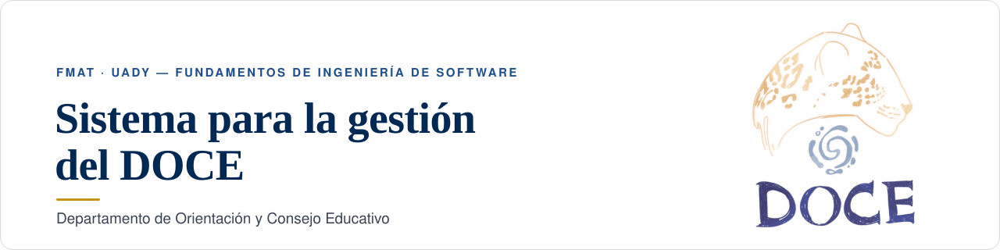

  

  Una plataforma web para que los talleres, avisos y apoyos de salud mental de la Facultad de Matemáticas 
  <b>lleguen al estudiantado</b> en lugar de perderse en el correo.

  
  
  

  <a href="#el-problema">El problema</a> ·
  <a href="#qué-incluye">Qué incluye</a> ·
  <a href="#estado-del-proyecto">Estado</a> ·
  <a href="#documentación">Documentación</a> ·
  <a href="#equipo">Equipo</a>

 

## El problema

Hoy las convocatorias del DOCE se envían por correo institucional. Entre tantos mensajes,
**los avisos se pierden** y muchas personas no se enteran de las actividades a tiempo.

> [!NOTE]
> **Nuestra propuesta:** un solo lugar donde consultar el calendario de actividades, los contactos
> de orientación y el material de salud mental, y donde el personal del DOCE pueda publicar
> y actualizar todo sin depender del correo.

## Qué incluye

**Para la comunidad estudiantil**, sin necesidad de iniciar sesión:

| Sección | Qué se puede hacer |
|---|---|
| Calendario | Ver las actividades y avisos publicados a partir de hoy, con su sede, fecha y hora |
| Detalle de actividad | Consultar la descripción, la modalidad (presencial, virtual o híbrida), el lugar o enlace y quién organiza |
| Directorio | Saber a quién acudir: nombre, cargo, ubicación, horario y contacto del personal de orientación |
| Líneas de ayuda | Consultar las líneas universitarias, locales, estatales y nacionales, siempre a la vista |
| Material informativo | Revisar folletos, videos y documentos sobre salud mental |
| Fotogalería | Ver las fotos de las actividades realizadas |
| Tutorías y guías | Consultar los contactos de tutoría y descargar las guías de carrera |

**Para el personal del DOCE**, con inicio de sesión:

| Función | Qué se puede hacer |
|---|---|
| Actividades y avisos | Crear, revisar, publicar, editar y cancelar |
| Líneas de ayuda | Registrar, modificar y eliminar |
| Material informativo | Agregar, actualizar y retirar |
| Fotogalería | Subir, editar y eliminar fotos con su descripción |

## Estado del proyecto

| Etapa | Estado |
|---|---|
| **Entrega 1** — Propuesta, problemática y objetivos | Entregada |
| **Entrega 2** — Requisitos, casos de uso, historias de usuario, bocetos, wireframes y prototipo | En curso |

## Documentación

| Tema | Dónde está | Contenido |
|---|---|---|
| Propuesta | `docs/propuesta.md` | Problemática, objetivos y usuarios |
| Requisitos funcionales | `Requisitos/Requisitos funcionales` | RF01 a RF11, cada uno con historia de usuario, criterios de aceptación y casos de uso |
| Requisitos no funcionales | `Requisitos/Requisitos no funcionales` | RNF01 a RNF06 con su criterio medible |
| Priorización | `Requisitos/Priorización de requisitos.md` | Clasificación MoSCoW y dependencias |
| Diagrama de casos de uso | `Requisitos/Diagrama de casos de uso` | Actores y casos de uso del sistema |
| Bocetos | `Diseño/Bocetos` | Una carpeta por requisito, con sus estados |
| Guías de diseño | `Diseño/Guías y herramientas de diseño.md` | Paleta 1c, tipografía, accesibilidad y herramientas |
| Wireframes y prototipo | `Diseño/Wireframes` | Estilo definido y prototipo navegable |
| Logotipo | `Diseño/Logotipo` | Logotipo vectorizado y versiones a una tinta |
| Proceso | `docs/proceso` | Descripción y gestión del proceso, y bitácoras de reunión |
| Roles y metas | `docs/roles y metas` | To-do de la entrega y métrica de contribución |
| Competencias | `docs/competencias` | Competencias genéricas y específicas |
| Referencias | `docs/bibliografía` | Referencias bibliográficas |
| Historial de prompts | `docs/Claude` | Instrucciones usadas con Claude y skills de diseño |

Los wireframes y el prototipo están en [Figma](https://www.figma.com/design/qplL37YMxA1qUtEYYCtmRH/Wireframe-definitivo). La presentación de la entrega está en este [video](https://youtu.be/VTZ2iUp1qRs?si=Mxc6zNCrfXF_YfDs).

## Equipo

| Integrante | Rol |
|---|---|
| Sofía Anael Barreiro Urcelay | Líder |
| Gabriel Eduardo Estrada Rejón | Integrante |
| Jennyfer Estefania Chan Tun | Integrante |
| Daniel Isai Yah Ku | Integrante |
| Jahzeel Alfonso Canul Ventura | Integrante |
| Rafael Jesús Jiménez Pereira | Integrante |

 

  Proyecto integrador de <b>Fundamentos de Ingeniería de Software</b> · Facultad de Matemáticas, UADY · Agosto–diciembre 2026

