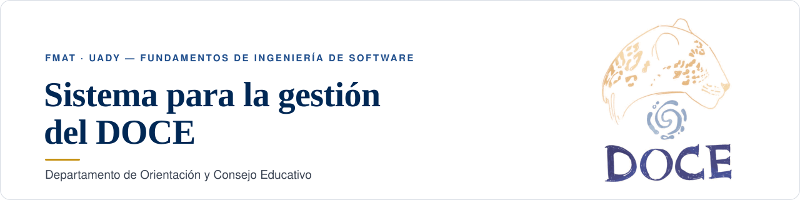

  

  Una plataforma web para que los talleres, avisos y apoyos de salud mental de la Facultad de Matemáticas 
  <b>lleguen al estudiantado</b> en lugar de perderse en el correo.

  
  
  

  <a href="#el-problema">El problema</a> ·
  <a href="#qué-incluye">Qué incluye</a> ·
  <a href="#estado-del-proyecto">Estado</a> ·
  <a href="#documentación">Documentación</a> ·
  <a href="#equipo">Equipo</a>

 

## El problema

Hoy las convocatorias del DOCE se envían por correo institucional. Entre tantos mensajes,
**los avisos se pierden** y muchas personas no se enteran de las actividades a tiempo.

> [!NOTE]
> **Nuestra propuesta:** un solo lugar donde consultar el calendario de actividades, los contactos
> de orientación y el material de salud mental, y donde el personal del DOCE pueda publicar
> y actualizar todo sin depender del correo.

## Qué incluye

<!-- Pendiente: se llenará al final del proyecto. -->

## Estado del proyecto

| Etapa | Estado |
|---|---|
| **Entrega 1** — Propuesta, problemática y objetivos | Entregada |
| **Entrega 2** — Requisitos, casos de uso, historias de usuario y bocetos | En curso |

## Documentación

<!-- Pendiente: se llenará al final del proyecto. -->

## Equipo

| Integrante | Rol |
|---|---|
| Sofía Anael Barreiro Urcelay | Líder |
| Gabriel Eduardo Estrada Rejón | Integrante |
| Jennyfer Estefania Chan Tun | Integrante |
| Daniel Isai Yah Ku | Integrante |
| Jahzeel Alfonso Canul Ventura | Integrante |
| Rafael Jesús Jiménez Pereira | Integrante |

 

  Proyecto integrador de <b>Fundamentos de Ingeniería de Software</b> · Facultad de Matemáticas, UADY · Agosto–diciembre 2026

