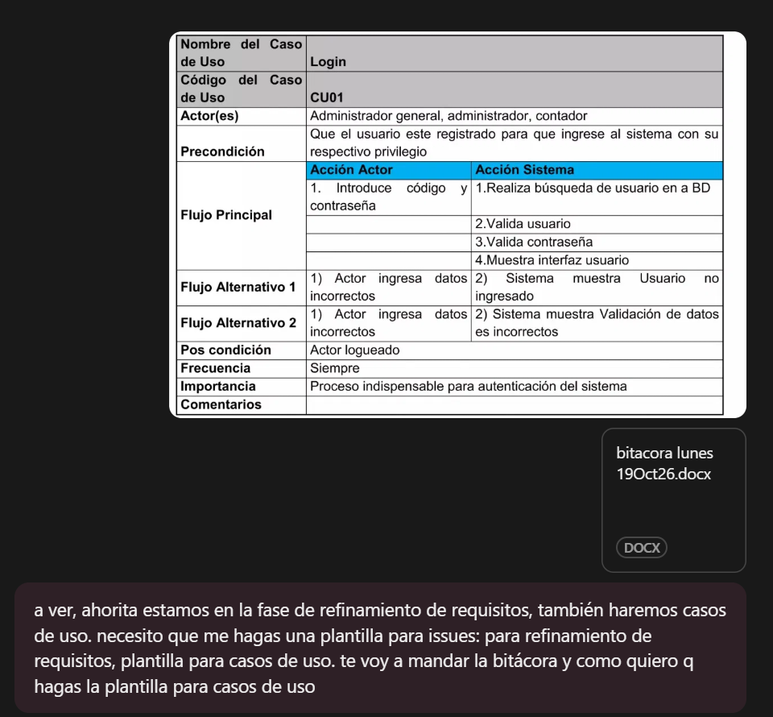
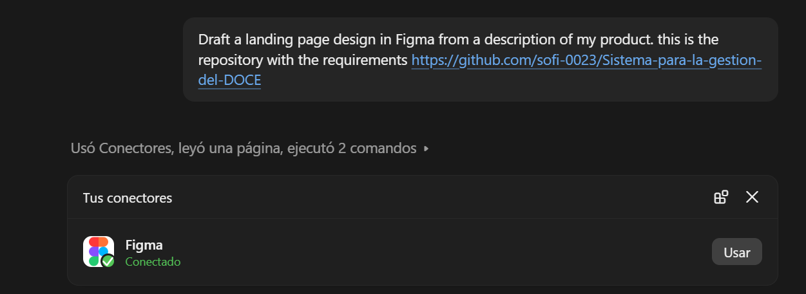
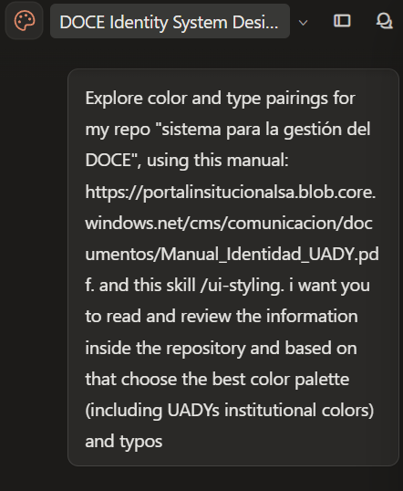
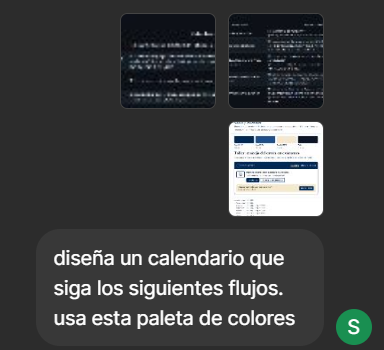
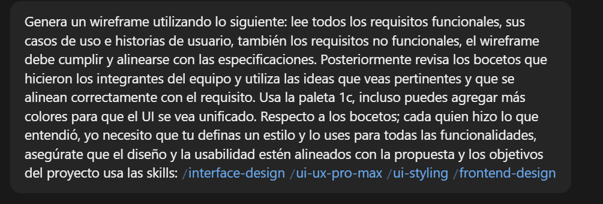
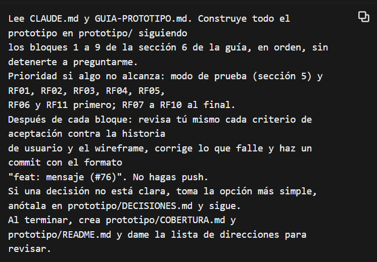

## Historial de prompts a claude para este proyecto

### Issue #75 – Verificar y ajustar RF10 y RF11 (Rafael, 22/11/2026)

Herramienta: Claude. Se le compartieron el issue #75, los casos de uso CU-13 y CU-14, las historias de usuario de RF10 y RF11, Wireframes y prototipo.md y capturas de las pantallas de Figma.

Prompt principal: "Necesito que me ayudes a completar el issue [#75]; indícame qué es lo que harás o qué más necesitas."

Claude comparó los archivos con Requisitos funcionales.md, Requisitos no funcionales.md (RNF04), Priorización de requisitos.md, los bocetos y los wireframes, propuso las correcciones y redactó el comentario del issue y la descripción del PR. Rafael revisó los cambios antes de subirlos.
### Issue #76 – Prototipo HTML (Sofía, 23/11/2026)

Herramienta: Claude Code, en la rama `feature/76-prototipo-html`. Se le compartieron `CLAUDE.md` (reglas del prototipo y fuentes de verdad) y la guía de construcción del prototipo, con los requisitos, historias de usuario, casos de uso y wireframes del repositorio.

Prompt principal:

Claude Code construyó el prototipo por bloques, revisó cada criterio de aceptación contra la historia de usuario y el wireframe, hizo un commit por bloque y dejó `prototipo/COBERTURA.md`, `prototipo/DECISIONES.md` y `prototipo/README.md`. Sofía revisó el resultado antes de abrir el PR #82.
